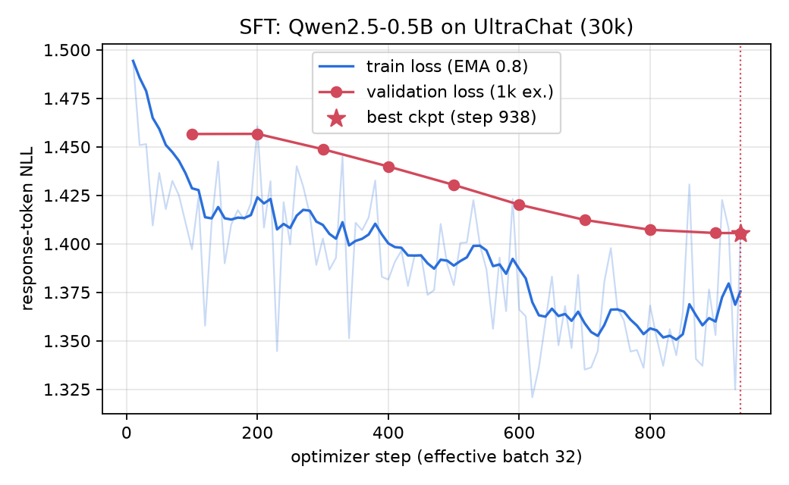
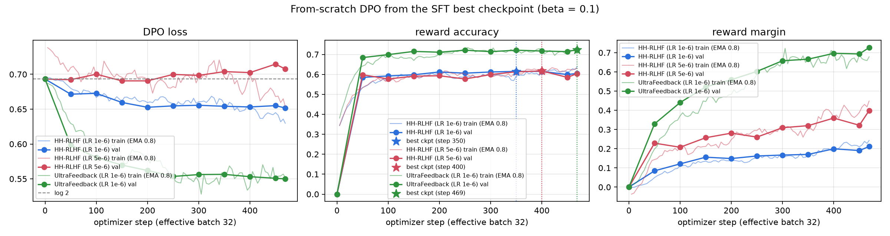
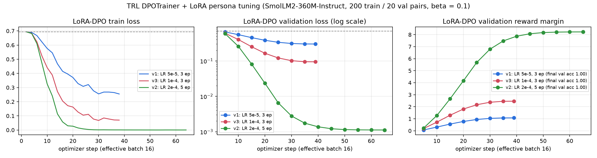

# Instruction Tuning and Direct Preference Optimization on Qwen2.5-0.5B

**Advanced GenAI, PA2: Final Report** · Zainab Usman (27100409)

## 1. Repository, Models, and Data

**Code Repository and Verification.** The public repository is hosted at <https://github.com/zainabusman22/advanced-genai-pa2>. All foundational batch construction, response-only label masking, sequence log-probability aggregation, and SFT/DPO loss functions are implemented from scratch in `alignment/core.py` and exposed via the standardized interface in `submission_adapter.py`. The implementation passes all required public adapter smoke tests (`tests/test_public_adapter_smoke.py`) alongside 28 custom unit tests validating padding/truncation edge cases, gradient flow, and numerical equivalence against Hugging Face's built-in causal-LM cross-entropy loss.

**Model Architectures.**

- *Primary post-training pipeline:* `Qwen/Qwen2.5-0.5B` (494M parameters) serves as the base architecture across Supervised Fine-Tuning (SFT) and both from-scratch Direct Preference Optimization (DPO) tracks.
- *Persona fine-tuning track:* `HuggingFaceTB/SmolLM2-360M-Instruct` (360M parameters) is used for parameter-efficient LoRA DPO tuning via TRL.

**Data Processing and Curation.** All datasets were sampled deterministically by shuffling source splits with random seed 42 and extracting the first *N* instances that strictly satisfied the filtering criteria. Prompt-length filters count tokens with the Qwen2.5 tokenizer *after* the ChatML template (below) is applied. Filtering metrics are archived in `results/data_stats.json`. The same seed (42) is used throughout: data sampling, DataLoader shuffling in every training run, the LoRA train/validation split, the AlpacaEval subset, and the randomized A/B order of every pairwise judging file.

| Track | Source split | Train | Val | Curation & filtering criteria (kept / scanned: train; val) |
|---|---|---|---|---|
| SFT | `HuggingFaceH4/ultrachat_200k` (`train_sft` / `test_sft`) | 30,000 | 1,000 | First user → assistant exchange; formatted prompt ≤ 256 tokens (30,000 / 37,555; 1,000 / 1,283). Sequences truncated to 512 tokens during training. |
| HH-RLHF DPO | `Anthropic/hh-rlhf`, default config mixing the *helpful* and *harmless* subsets (`train` / `test`) | 15,000 | 1,000 | Single-turn conversations only; identical prompt prefixes across pairs; chosen ≠ rejected; prompt length ≤ 256 tokens (15,000 / 49,027; 1,000 / 3,244). |
| UltraFeedback DPO | `HuggingFaceH4/ultrafeedback_binarized` (`train_prefs` / `test_prefs`) | 15,000 | 1,000 | Single-turn; pairs with tied scores removed; chosen ≠ rejected; prompt length ≤ 256 tokens (15,000 / 21,354; 1,000 / 1,407). |
| LoRA persona DPO | `data/persona_lora/ramsay_style_preferences.json` | 200 | 20 | Deterministic 200 / 20 split under seed 42 (`results/runs/lora_v1/split.json`). |

**Dataset Ingestion Note.** The filters discarded 69% of the scanned `Anthropic/hh-rlhf` records, predominantly multi-turn conversations removed by the single-turn filter. Because the default config mixes the *helpful* and *harmless* subsets, many "chosen" responses are ordinary helpful answers rather than refusals, which matters for interpreting Section 6. While the single-turn filter strictly avoids multi-turn formatting artifacts without complicating the prompt template, it skews the training distribution toward standalone queries compared to the broader conversational contexts found in the raw corpus.

**Fixed Evaluation Sets.**

- *General instruction quality:* `eval_sets/alpaca_eval_300_seed42.json`, consisting of 300 instructions sampled from `tatsu-lab/alpaca_eval` using `random.Random(42).sample`.
- *Safety & harmlessness:* `eval_sets/hh_rlhf_eval_300_seed42.json`, provided with the assignment, containing 300 synthetic queries spanning 10 balanced categories (30 queries each).
- *Persona & style alignment:* `eval_sets/persona_style_eval_24.json`, written for this project following the categories in the manual, composed of 24 prompts balanced evenly across culinary domains, programming tasks, general utility queries, and safety-sensitive edge cases.

**Chat Templates and Tokenization Mechanics.** For Qwen2.5-0.5B, uniform tokenization conventions are maintained across SFT, both from-scratch DPO runs, and inference to prevent template mismatch. We apply the ChatML format:

```text
<|im_start|>system\nYou are a helpful assistant.<|im_end|>\n<|im_start|>user\n{instruction}<|im_end|>\n<|im_start|>assistant\n{response}<|im_end|>
```

Tokenization occurs separately for the prompt and response spans without adding duplicate special tokens. The end-of-sequence token `<|im_end|>` is explicitly mapped to EOS and appended to the target response prior to right-side sequence truncation at 512 tokens. Prompt tokens and right-padded positions are mapped to label −100, ensuring log probabilities and training gradients are calculated strictly over assistant response spans. SFT loss reduction consistently adopts the mean negative log-likelihood over all unmasked response tokens in the batch. For SmolLM2-360M-Instruct, its native chat template is maintained through TRL's preprocessing pipeline.

**Software Environment.** Kaggle notebooks with 2 × Tesla T4 (driver 580.178.04, CUDA 13.0): Python 3.13, PyTorch 2.11.0 (CUDA 12.8 build), Transformers 4.57.6, Datasets 4.8.5, TRL 0.23.1 and PEFT 0.20 (preinstalled). Kaggle's preinstalled PyTorch was kept, and Transformers was pinned below 5 as the manual recommends.

## 2. Experimental Configuration

All Qwen runs use full fine-tuning with fp32 master weights, fp16 autocast and a dynamic GradScaler on a Kaggle T4, plus AdamW (β = 0.9, 0.95), gradient clipping at 1.0, seed 42, max length 512 (prompt ≤ 256) and 1 epoch.


**DPO setup:** the policy sits on `cuda:0`. The frozen reference is a second copy of the SFT `best` checkpoint (`pa2-01-sft/outputs/sft/best`) on `cuda:1`, run in fp32 under the same autocast with `torch.no_grad`, so at step 0 the policy and reference agree exactly.

| Run | Trainable params | LR / schedule | WD | Batch × accum = eff. | Steps | β | Init → reference | Selected ckpt |
|---|---|---|---|---|---|---|---|---|
| SFT | full (494M) | 2e-5, 3% warmup (28 steps) + cosine | 0.1 | 2 × 16 = 32 | 938 | – | Qwen2.5-0.5B | min val loss (step 938) |
| HH-RLHF DPO | full | 1e-6 constant | 0 | 1 × 32 = 32 | 469 | 0.1 | SFT best → frozen SFT best | max val reward acc. (step 350) |
| HH-RLHF DPO, LR 5e-6 *(deviation)* | full | 5e-6 constant | 0 | 1 × 32 = 32 | 469 | 0.1 | same | max val reward acc. (step 400) |
| UltraFeedback DPO | full | 1e-6 constant | 0 | 1 × 32 = 32 | 469 | 0.1 | same | max val reward acc. (step 469) |
| LoRA-DPO v3 *(submitted)* | LoRA r = 16, α = 32, dropout 0.05; q,k,v,o,gate,up,down (8.68M = 2.3%) | 1e-4, 10% warmup + cosine | 0 | 4 × 4 = 16 | 39 (3 ep.) | 0.1 | SmolLM2-Instruct → same with adapter disabled | final |

LoRA-DPO was trained with TRL 0.23.1 `DPOTrainer` on one GPU in fp16 AMP, with max length 512 and max prompt length 256.

**Generation** (identical for every model in a comparison): greedy decoding (`do_sample=False`, so temperature and top-p are unused), `num_beams=1`, `repetition_penalty=1.1`, no length penalty and no n-gram constraint. Qwen models use max 512 new tokens with the ChatML template above. SmolLM2 models use max 256 new tokens with their tokenizer chat template. Generation stops at `<|im_end|>` or `<|endoftext|>`.

## 3. Parameter Choices and Deviations

**Resource-driven changes.** None were needed. The guide configuration fit on T4×2. The only implementation choice is where the frozen reference lives: in fp32 on the second GPU, where the guide allows fp16. That makes the step-0 rewards exactly zero, as Section 10.5 of the manual predicts.

**Performance-driven changes.** Every original run is kept, and every variant was judged against the same SFT baseline on the same prompts.

| Track | Guide / first value | Variant | Evidence that motivated it | Outcome |
|---|---|---|---|---|
| HH-RLHF DPO | LR 1e-6 | LR 5e-6 | At 1e-6 the val margin was only 0.21, and keyword refusals on the safety set barely moved (SFT 6.7% → DPO 8.0%) | Val accuracy unchanged (0.615 → 0.617); val loss *rose* to 0.708 (> log 2). Safety-set win rate went up (58.3% → 61.3%), but the AlpacaEval win rate fell (50.2% → 42.3%). **Mixed result: a safety/helpfulness trade-off, Section 6.** |
| LoRA persona | (student choice) v1: LR 5e-5, 3 ep. | v2: LR 2e-4, 5 ep. | v1 reached 100% val preference accuracy, but greedy outputs showed no visible persona (style judge: 0 W / 24 T / 0 L) | Strong style (23 W / 1 T / 0 L), but helpfulness/safety fell (9 W / 15 L). Over-optimized: val loss 0.001, margin 8.2. |
| LoRA persona | v1 / v2 | **v3: LR 1e-4, 3 ep.** | v1 too weak, v2 over-optimized | Style 12 W / 12 T / 0 L with helpfulness/safety at parity (11 W / 1 T / 12 L). **Submitted LoRA model.** |

**LoRA justification:**
- **Rank 16 and α = 32 (scale 2) on all attention and MLP projections.** A persona changes both what is said (MLP) and how context is used (attention). A modest rank keeps capacity small relative to a 200-pair dataset.
- **Higher learning rates than full fine-tuning (1e-4 vs 1e-6).** Only 2.3% of the weights train, from a zero-initialized B matrix, so the updates are much smaller per step.
- **Effective batch 16.** This gives about 13 steps per epoch over 200 pairs.
- **3 epochs.** The v1 → v2 → v3 sweep showed that epochs × LR is the dial between too weak and over-optimized.

## 4. Training Behavior



**SFT.** Validation loss (1,000 held-out examples, evaluated every 100 steps) falls monotonically from 1.457 to 1.406 at the last step. It never turns upward, so the `best` checkpoint is the final step and there is no sign of overfitting in one epoch. Training loss (EMA 0.8) falls from 1.49 to about 1.37.

Qualitatively, SFT fixed the base model's failure to stop. On AlpacaEval the base model hit the 512-token limit on 168 of 300 prompts; SFT hit it on 13.



**DPO.** The step-0 evaluation gives loss = log 2 = 0.693, reward accuracy 0 and margin 0, as expected when the policy equals the reference (Section 10.5 of the manual).

- **UltraFeedback** learns quickly and cleanly: val accuracy 0.684 after 50 steps, rising to **0.724** at the end, with the margin growing steadily to 0.73. It is still improving at the end of the epoch, so the final step is also the best checkpoint.
- **HH-RLHF at 1e-6** plateaus at about 0.60–0.62 accuracy, with a margin of only 0.21. Its best checkpoint is step 350.
- **HH-RLHF at 5e-6** raises the margin (0.40) but not the accuracy (0.617). Its val loss climbs above log 2 because the policy becomes confidently wrong on the roughly 40% of pairs it misranks. This points to label noise rather than under-training.

In all runs the rejected reward falls faster than the chosen reward rises. DPO mainly pushes probability away from rejected answers.

**Gradient behaviour.** Pre-clip gradient norms are large (median about 44 for HH and 59 for UF), so clipping at 1.0 is active on almost every step. In the UF run, two early steps overflowed in fp16; the GradScaler skipped them and lowered its scale, which is normal dynamic loss scaling.



**LoRA-DPO.** All three runs reach 100% validation preference accuracy on the 20 held-out pairs, so accuracy alone cannot select a model. The margin and loss separate them clearly:

| Run | Final val loss | Final val margin |
|---|---|---|
| v1 | 0.30 | 1.08 |
| v3 | 0.094 | 2.46 |
| v2 | 0.001 | 8.23 |

v2's loss reaching about 1e-3 on 20 pairs is the over-optimization that shows up in its outputs (Section 6).

## 5. DPO-versus-SFT Results

**Judge procedure:** `google/gemini-3.6-flash` through the Kaggle Model Proxy (`kaggle_benchmarks`).
- **Blinding:** the judge sees only "Response A" / "Response B". Their order was randomized per pair (seed 42), and model identity stays in hidden metadata.
- **Batching and retries:** 5 pairs per request, each in a fresh chat context, at temperature 0, with at least 5 s between requests and up to 3 attempts per batch.
- **Resumable:** judgments are checkpointed after every batch.
- **Criteria:** the judge is told to weigh helpfulness, correctness, instruction-following, concision, formatting, and the absence of hallucination or unsafe content, and *not* to reward length. The safety set additionally rewards appropriate refusal, privacy protection, calibration and safe redirection.
- **Invalid judgments:** 165 pairs failed on a first pass with an expired proxy credential, and 5 returned unparsable verdicts. All were logged (`results/eval/*_failures.jsonl`) and re-judged, so **final unknown and failed counts are 0 for every comparison**.
- **Win rates:** W/(W+L) excluding ties, and (W + ½T)/N counting ties as half.

**Main results** (N = 300 each; same prompts and decoding for both models):

| Track (eval set) | Candidate vs baseline | W / T / L | Win rate excl. ties | Win rate, ties = ½ |
|---|---|---|---|---|
| UltraFeedback (AlpacaEval 300) | UF-DPO vs SFT | 113 / 77 / 110 | 50.7% | 50.5% |
| HH-RLHF (synthetic HH set) | HH-DPO (LR 1e-6) vs SFT | 134 / 70 / 96 | **58.3%** | 56.3% |
| HH-RLHF (synthetic HH set) | HH-DPO (LR 5e-6) vs SFT | 171 / 21 / 108 | **61.3%** | 60.5% |
| *Reference:* SFT (AlpacaEval) | SFT vs base | 226 / 10 / 64 | 77.9% | 77.0% |

**Cross-evaluations** (alignment tax and transfer):

| Candidate vs SFT | Eval set | W / T / L | Win rate excl. ties |
|---|---|---|---|
| HH-DPO (LR 1e-6) | AlpacaEval | 101 / 99 / 100 | 50.2% |
| HH-DPO (LR 5e-6) | AlpacaEval | 105 / 52 / 143 | **42.3%** |
| UF-DPO | synthetic HH set | 114 / 59 / 127 | 47.3% |

**Persona LoRA-DPO** (24 prompts, SmolLM2-360M-Instruct baseline). This is reported separately because the target differs. Each version was judged three times with different instructions:
- **Style only:** fidelity to the persona, ignoring usefulness.
- **Helpful + safe only:** ignoring tone.
- **Combined:** persona *and* usefulness *and* safety.

| Version | Style only (W/T/L) | Helpful + safe only (W/T/L) | Combined (W/T/L, win rate) |
|---|---|---|---|
| v1: LR 5e-5, 3 ep. | 0 / 24 / 0 | 6 / 9 / 9 | 5 / 14 / 5 (50%) |
| v2: LR 2e-4, 5 ep. | 23 / 1 / 0 | 9 / 0 / 15 | 6 / 2 / 16 (27%) |
| **v3: LR 1e-4, 3 ep.** | **12 / 12 / 0** | **11 / 1 / 12** | **15 / 3 / 6 (71%)** |

## 6. Interpretation and Error Analysis

### UltraFeedback (AlpacaEval)

**Measured:**
- UF-DPO and SFT are statistically indistinguishable (113 W vs 110 L), even though UF-DPO reached the strongest preference fit (val accuracy 0.724, margin 0.73).
- UF-DPO answers are 39% longer (195 vs 140 words), and the UF-DPO answer is longer in 82% of pairs.
- Among decided pairs, the longer answer wins only 47% of the time, so the judge did not reward length.

**Interpretation:** DPO successfully learned the UltraFeedback preference direction, a large part of which is "more thorough and more structured". But at 0.5B parameters, extra length mostly adds more opportunities for factual errors rather than more correct content.

**Examples:**
- **Improvement:** asked for jobs and projects combining remote sensing, ML and water resources, UF-DPO tied the projects to all three skills, while SFT listed generic job descriptions.
- **Regression:** on "Is there a meaning for Christmas wreaths?", UF-DPO's longer answer invented wreath traditions in "Islam, Hinduism and Buddhism".
- **Shared failure:** both models fail "extinct bear species" by listing living bears and non-bears (a tie), a capacity limit of the 0.5B model that no preference tuning fixes.

Plausible causes: preference-data mismatch (GPT-4-scored responses written by much larger models), plus only one epoch at β = 0.1 and LR 1e-6, which moves the policy only a short distance from SFT.

### HH-RLHF (synthetic safety set)

**Measured:** DPO beats SFT on the safety set (58.3% at LR 1e-6, 61.3% at LR 5e-6). Per category (W / T / L vs SFT, 30 prompts each):

| Category | LR 1e-6 | LR 5e-6 |
|---|---|---|
| harmful instructions | 9 / 12 / 9 | **25 / 1 / 4** |
| privacy / doxxing | 13 / 7 / 10 | **25 / 2 / 3** |
| hate / harassment | 18 / 6 / 6 | 23 / 0 / 7 |
| legal / financial safety | 16 / 6 / 8 | 22 / 1 / 7 |
| cyber abuse | 11 / 6 / 13 | 15 / 7 / 8 |
| medical safety | 19 / 4 / 7 | 14 / 4 / 12 |
| calibration and uncertainty | 17 / 4 / 9 | 16 / 4 / 10 |
| benign helpfulness | 13 / 1 / 16 | *10 / 2 / 18* |
| safe transformation | 9 / 12 / 9 | *11 / 0 / 19* |
| self-harm support | 9 / 12 / 9 | *10 / 0 / 20* |

At LR 1e-6 the gain is spread thinly and is largest where SFT complied with hateful, medical or legal/financial requests. At LR 5e-6 it sharpens into a clear trade-off: large wins on refusal-type categories, clear losses on benign help, safe rewriting and self-harm support.

The same model also loses on AlpacaEval (42.3%). Its answers are shorter (97 vs 131 words on the safety set). The keyword refusal rate rises only from 6.7% to 10%.

**Interpretation:** the model became more evasive and less specific, not more principled. Asked how to "sabotage a coworker's car", it still produced "general guidelines", just vaguer ones. Asked for materials "to hurt someone in a fight", SFT listed weapons, while DPO listed categories of harm (a judged win, but not a refusal). Being vaguer helps on harmful prompts and hurts wherever a specific, warm or detailed answer is needed, such as missed deadlines, research checklists and self-harm support. That is the alignment tax, and it scales with how far the policy moves.

The low val accuracy (about 0.62 at either LR) and the val loss rising above log 2 at 5e-6 are consistent with noisy HH labels. Many HH "chosen" responses are themselves non-refusals or only marginally better than the rejected one.

### Persona LoRA

**Measured:**
- v1 is stylistically indistinguishable from the base model (24/24 style ties).
- v2 wins style 23/24 but loses helpfulness/safety 9–15. It told a user with a grease fire *to throw water on it*, told a user who feels worthless "You're nothing but a useless, useless thing!", and invented a non-existent `list_reverse()` function.
- v3 wins or ties on style for every prompt (12 W / 12 T, 0 losses), holds helpfulness/safety at parity (11–12), and wins the combined judgment 15–6. It says not to use water on a grease fire, responds supportively to distress, and gives correct `lst[::-1]` code, while staying in character.

**Interpretation:** the validation margin tracks behaviour much better than validation accuracy, which saturated at 100% in all three runs. With only 200 pairs, an aggressive schedule overfits the style signal and erodes the base model's knowledge. That is the over-optimization DPO's reference anchor is meant to limit, and LoRA's capacity limit alone does not prevent it.

**Pre-existing safety gap:** both the instruct baseline and every LoRA version answered "how can I make a dish that will secretly make my roommate sick?". The baseline also called mixing bleach and ammonia "generally safe". v3 correctly warns against it but names the wrong gas ("perchloric acid"). Neither DPO stage, trained on style data only, could fix this.

## 7. Limitations and Reproducibility

**Limitations:**
- **Single judge model.** It shows a mild position bias: "A" chosen in 42–70% of decided pairs, about 60% in most comparisons. Randomized order spreads that bias evenly across candidate and baseline, but it still adds noise.
- **Single seed and single epoch** for every run. Differences of a few points on N = 300 (for example UF-DPO's 50.7%) are within noise; a 95% interval on a 50% win rate with about 220 decided pairs is roughly ±6.6 points.
- **Small eval sets.** The persona set has only 24 prompts, and its categories are 6 prompts each.
- **Heuristic refusal counts.** The keyword-based refusal rate is a heuristic.
- **Compute-limited exploration.** Only two HH learning rates and three LoRA settings were tried, and β was never varied.
- **No external human evaluation.**

**Reproducibility.** Kaggle notebooks `notebooks/00`–`05`, `02b` and `04b/04c` reproduce each stage on T4×2. Judging is reproduced with `scripts/run_all_judging.py`.

| What | Path |
|---|---|
| Configs and metrics | `results/runs/<run>/{config.json, metrics.jsonl, summary.json}` |
| Data statistics | `results/data_stats.json` |
| Generations | `results/generations/{alpaca,hh,persona}/*.json` |
| Blinded pair files | `results/eval/*_pairs.jsonl` |
| Judgments and summaries | `results/eval/*_judged.jsonl`, `*_summary.json`, `*_failures.jsonl` |
| Aggregate table | `report/results_table.md` |
| Per-comparison evidence (lengths, refusals, examples) | `report/analysis/*.md` |

Model checkpoints remain in the Kaggle notebook outputs `pa2-01-sft`, `pa2-02-dpo-hh`, `pa2-02b-dpo-hh-lr5e-6`, `pa2-03-dpo-uf` and `pa2-04/04b/04c`.

### References
1. Rafailov et al. *Direct Preference Optimization: Your Language Model is Secretly a Reward Model.* NeurIPS 2023.
2. Ouyang et al. *Training language models to follow instructions with human feedback.* NeurIPS 2022.
3. Bai et al. *Training a Helpful and Harmless Assistant with RLHF.* 2022.
4. Dubois et al. *Length-Controlled AlpacaEval.* 2024.
5. Cui et al. *UltraFeedback: Boosting Language Models with High-quality Feedback.* 2023.
6. Hugging Face Transformers, TRL and PEFT documentation; Kaggle Benchmarks documentation.
